# OpenCV去噪对目标检测的影响
## 计算机视觉第三章 · 作业2实验报告

实验共设置114组条件，完成14,592次图像推理，使用固定预训练模型。检测指标由逐图预测记录通过COCO官方评价程序计算。实验指纹：12246ba7577ed58cef665d01aae647570b7c984a3f3862d31c195095fa849f4d。

## 摘要

本实验比较均值、高斯、中值、双边和彩色非局部均值滤波与不去噪，在128张COCO验证图像上检验画质与检测精度的关系。噪声包含三档高斯噪声和三档椒盐噪声，每档使用三个种子，另加入六种干净输入对照。干净不滤波的mAP@0.5:0.95为43.27%。在每类噪声的15个“方法×强度”比较中，高斯噪声有11个、椒盐噪声有7个滤波选项的平均AP高于对应不去噪基线。收益取决于噪声模型、强度和滤波方式，图像质量指标不能代替任务评价。

## 1. 实验目的与问题

课程要求用OpenCV实现去噪，并简略比较不同方法对后续目标检测的影响。本实验进一步回答三个问题：去噪能否恢复被噪声破坏的目标证据；去噪是否同时抹掉小目标、轮廓与纹理；PSNR/SSIM提高是否对应检测改善。作业1讨论的UniRestore按任务恢复图像，DCP-SFR保留弱异常线索；本作业以传统方法建立可解释的像素处理对照。

工作假设是：中值对脉冲噪声通常更适合，平均操作可降低独立随机噪声，但可能模糊边界。这些是方法机理提出的预期，不作为实验排名。所有滤波参数在完整实验前固定，没有使用评测结果调参。

## 2. 噪声模型与去噪原理

### 2.1 高斯噪声和椒盐噪声

高斯噪声在各像素各颜色通道独立生成，标准差使用0—255尺度。先转浮点相加，再裁剪与四舍五入回uint8，避免8位整数回绕：

$$Y=\mathrm{round}\left(\mathrm{clip}(X+\epsilon,0,255)\right),\quad \epsilon\sim\mathcal{N}(0,\sigma_n^2)$$

σ_n取10、25、50。靠近0或255处裁剪会改变实际扰动分布，这里的σ_n描述裁剪前的噪声；裁剪后，靠近像素范围边界的扰动分布会发生变化。

椒盐噪声按像素位置抽一个u∈[0,1)，u<p/2时三个通道同时置0，p/2≤u<p时置255，其余保留原像素。p取0.01、0.03、0.05，是期望污染位置比例，有限图像中的实际比例会波动。两个模型均是合成退化，不代表真实相机全部噪声。

同一图像、噪声类型、强度与种子生成同一随机流。SHA256散列的前8字节生成NumPy随机数生成器种子；方法名称不参与散列，因而六个方法处理完全相同的噪声实例。

### 2.2 均值与高斯滤波

均值对邻域等权平均，是线性低通滤波。窗口越大通常越平滑，也越容易混合目标与背景：

$$\hat{X}(p)=\frac{1}{|\Omega|}\sum_{q\in\Omega(p)}Y(q)$$

高斯滤波仍是线性加权平均，但离中心越近权重越大。σ_f表示滤波核标准差，与生成噪声用的σ_n不同：

$$G(q)\propto\exp\left(-\frac{\|q\|^2}{2\sigma_f^2}\right),\quad \hat{X}=G*Y$$

二者适合降低局部随机波动，但不能判断高频是噪声还是细小目标。课程第30页将均值列入非线性，与第31/36页的线性滤波示例不一致；固定权重的均值与高斯在数学上均为线性操作。

### 2.3 中值滤波

中值用邻域排序后的中间值替代中心值，本实验按各通道处理：

$$\hat{X}(p)=\mathrm{median}\{Y(q):q\in\Omega(p)\}$$

少量极端黑白脉冲不容易改变排序中间值，因此中值适合椒盐噪声。它是非线性操作；细线、小点、狭窄目标也可能因邻域多数表决而消失。

### 2.4 双边滤波

双边同时考虑空间距离和颜色差异，通过归一化权重平均：

$$\hat{X}(p)=\frac{\sum_q w_s(p,q)w_c(p,q)Y(q)}{\sum_q w_s(p,q)w_c(p,q)}$$

空间权重与颜色权重均按高斯形式衰减，后者由当前图像内容决定，因此为非线性滤波。颜色差大的真实边缘可以少混合，但严重噪声造成的颜色差也可能被当成边缘保留下来。

### 2.5 彩色非局部均值

非局部均值比较图像块而非只比较单个像素，在搜索区域寻找外观类似的块：

$$\hat{X}(p)=\sum_q w(p,q)Y(q),\quad w(p,q)\propto\exp\left(-\frac{d(P_p,P_q)}{h^2}\right)$$

这是解释机理的简化表达；OpenCV彩色实现内部转到Lab并分别处理亮度与颜色，采用快速算法。本实验调用fastNlMeansDenoisingColored完成处理，以上公式仅用于说明其加权思想。相似纹理有利于平均抑噪；h过强会损失细节，h固定而噪声很强时又可能去除不足。搜索窗口较大使其耗时明显增加。

| 方法 | 本实验固定参数 | 主要取舍 |
|---|---|---|
| 不去噪 | 复制输入 | 保留噪声与全部原细节 |
| 均值 | 3×3 | 低成本平滑，边界可能模糊 |
| 高斯 | 3×3，σ_f=1 | 中心权重较大，仍有细节损失 |
| 中值 | 3×3 | 对脉冲稳健，窄结构可能消失 |
| 双边 | d=5，σColor=25，σSpace=25 | 边缘保护依赖当前颜色差 |
| 彩色非局部均值 | h=10，hColor=10；模板7、搜索21 | 利用块相似性，计算开销较大 |

均值、高斯、双边使用BORDER_REFLECT_101；中值与非局部均值沿用OpenCV内部边界约定。全部处理彩色BGR uint8数组，输出形状保持一致。

## 3. 数据、环境与实验流程

### 3.1 数据来源与固定抽样

从官方COCO val2017的5,000张图像按图像ID排序，用NumPy default_rng(20260930)无放回抽取128个索引，再按ID排序保存。共有1025个标注，其中1012个非crowd对象；具有非crowd真值的类别为75/80。未出现真值的类别按COCO默认方式不计入AP均值，因此不能把本子集AP与整个COCO榜单直接比较。

最长边缩至最多640，不放大较小图像，INTER_AREA插值。由于尺寸取整，分别记录sx=新宽/原宽、sy=新高/原高，真值[x,y,w,h]分别乘sx、sy；area乘sx×sy，保留iscrowd。评价是bbox，删除不参与本作业的分割多边形。PNG避免二次JPEG压缩。

data_manifest.json保留128个ID、下载URL、原图/处理图SHA256、许可与精确缩放比例；annotations_resized.json保存正式真值。COCO图像版权与使用许可归原作者，案例图按清单中的COCO来源追溯。所有噪声实验共用该子集，未训练检测器或用验证集选参数。

### 3.2 实际执行环境

硬件：NVIDIA GeForce RTX 5070 Ti；全部正式条件使用设备0，无CPU/GPU结果混用。系统：Windows-11-10.0.26200-SP0。推理精度float32，OpenCV固定单线程，PyTorch CPU线程数4。

| 环境项目 | 实际版本 |
| --- | --- |
| Python | 3.13.6 |
| PyTorch | 2.7.1+cu128 |
| CUDA | 12.8 |

| 软件 | 实际版本 |
| --- | --- |
| ultralytics | 8.4.166 |
| opencv-python | 5.0.0.93 |
| numpy | 2.3.3 |
| scikit-image | 0.26.0 |
| pycocotools | 2.0.11 |

初建本地虚拟环境时为复用已安装依赖启用了system-site-packages，后在该环境中单独安装CUDA 12.8版PyTorch。交付的setup_env.ps1为新机器创建普通隔离虚拟环境，不要求使用原系统依赖。requirements.txt固定直接依赖，环境记录保存实际版本，首次联网安装过程受镜像与驱动可用性影响。

模型为Ultralytics官方YOLO11n COCO预训练权重，来源v8.3.0发布资产。SHA256：0ebbc80d4a7680d14987a577cd21342b65ecfd94632bd9a8da63ae6417644ee1。固定imgsz640、rect=False、augment=False、NMS IoU0.7、max_det100、推理置信度0.001。模型API返回映射回处理图像的xyxy，转换为COCO xywh；YOLO的0—79类别索引映射为完整COCO类别ID列表，不能简单加1。

### 3.3 流程与分组

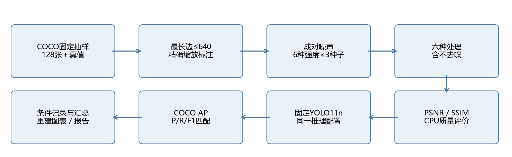

图1：正式执行流程。同一图像、强度与种子下，各方法重建相同的噪声输入并独立处理；检测器参数全程固定。

6组干净输入（原图与五种滤波）＋2类噪声×3强度×3种子×6方法=114个条件，每条件128张图像。先完成3项基础验证、单图六方法检测及8张×8条件小规模实验，随后运行完整矩阵。

入口依次为prepare.py准备数据、demo.py分阶段演示、run_experiment.py批量运行、generate_report.py汇总已有预测。报告生成不重新推理，而是从records中的预测框重建检测展示。每条件原子保存压缩逐图记录与JSON摘要。配置、数据、模型、设备和核心代码哈希共同构成指纹；不匹配时拒绝恢复，防止不同实验混合。

### 3.4 指标定义与计时边界

PSNR=10log10(255²/MSE)，MSE对全部像素和三个颜色通道计算，先转float64防止uint8减法回绕。SSIM用scikit-image、data_range255、channel_axis2，默认7×7窗口及其他默认参数；各图同权平均。干净不处理的MSE=0、PSNR=∞，JSON使用null表示此特殊值，不能把它解释为缺测或0 dB。

mAP@0.5与mAP@0.5:0.95使用官方pycocotools.COCOeval bbox、101点召回插值、同类别匹配、crowd忽略与maxDets100。后者平均IoU0.50至0.95、步长0.05；AP使用置信度0.001以上的全部保留预测，并非只使用0.25以上预测。

固定阈值Precision=TP/(TP+FP)、Recall=TP/(TP+FN)、F1=2PR/(P+R)，在置信度≥0.25、IoU≥0.5下按COCO逐类别匹配，合并所有图像计算micro指标。重复预测只允许一个匹配同一普通真值，错类别不能匹配；crowd忽略项不作为FP/FN。先每种子计算整个子集指标，再对三个种子取均值与样本标准差（ddof=1），不是对逐图AP平均。

去噪时间仅覆盖滤波调用。检测计时从模型调用前开始，到预测框、分数和类别转为CPU上的NumPy数组后结束，GPU在计时前后同步；随后将xyxy转为xywh并组装预测字典的Python循环不在该区间内。磁盘读写、质量评价、绘图和三次预热均不计入耗时。记录逐图平均与中位数。正式方法按固定顺序运行；期间同时进行文档生成和少量演示验证，背景负载、温度、调度均可能影响耗时，所以其为本机工程记录，未作为严格微基准或显著性检验。误差条为三个噪声种子的标准差，不能解释为跨数据集泛化置信区间。

## 4. 实验结果与可视化

### 4.1 干净输入对照

| 处理 | AP50:95（%） | F1（%） | PSNR（dB） | SSIM |
| --- | --- | --- | --- | --- |
| 不去噪 | 43.27 | 61.41 | ∞ | 1.000 |
| 均值 | 42.23 | 58.40 | 27.07 | 0.815 |
| 高斯 | 42.69 | 59.06 | 28.40 | 0.863 |
| 中值 | 42.11 | 59.67 | 28.08 | 0.832 |
| 双边 | 43.23 | 61.01 | 39.21 | 0.965 |
| 非局部均值 | 40.81 | 56.81 | 30.05 | 0.822 |

表1：干净对照只有一组确定输入，不绘制跨噪声种子的误差条。直接滤波会改变边界与纹理，必须保留该对照，才能判断算法自身带来的代价。

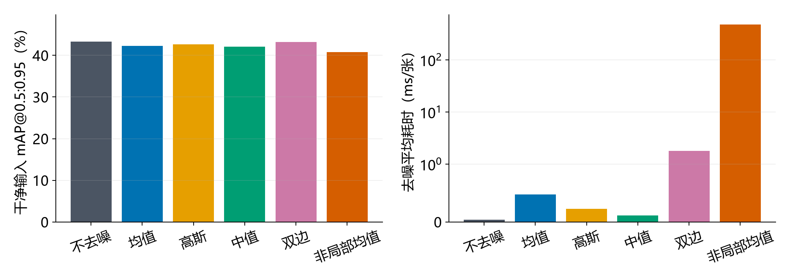

图2：左为干净对照AP，右为每种方法在7个汇总组上的平均去噪耗时，包括1个干净组及6个噪声类型与强度组合；每个噪声组先对三个种子取均值。右图使用对称对数坐标，线性区间0—1 ms；柱高不能按线性比例直接比较。

### 4.2 两类噪声和强度趋势

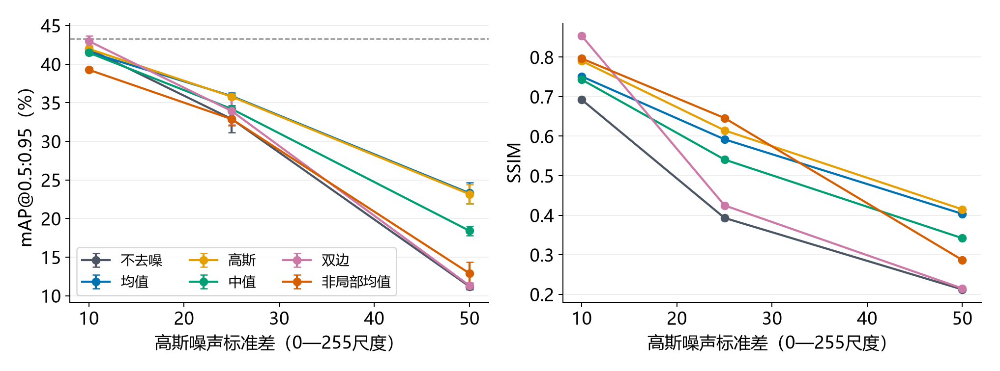

图3：高斯噪声下AP与SSIM，点为三个种子均值，误差条为标准差。AP面板虚线为干净不处理参考。

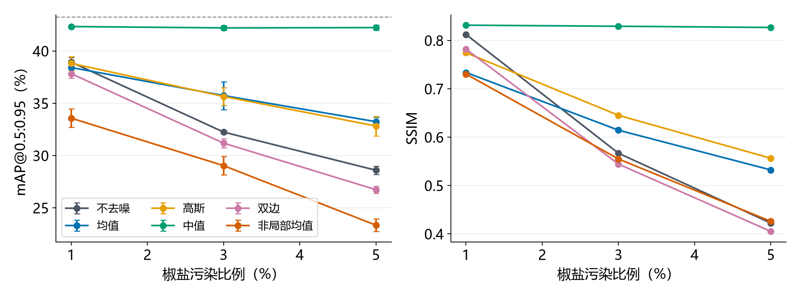

图4：椒盐噪声下AP与SSIM，横轴以百分比标注。三个种子改变噪声的随机分布位置，图像子集与检测器保持不变。

| 输入 | 最高平均AP选项 | AP50:95（%） | 较不去噪Δ百分点 | 最高PSNR选项 |
| --- | --- | --- | --- | --- |
| gaussian 10 | 双边 | 42.97 | +1.04 | 双边 |
| gaussian 25 | 均值 | 35.86 | +2.97 | 高斯 |
| gaussian 50 | 均值 | 23.29 | +12.10 | 高斯 |
| salt_pepper 0.01 | 中值 | 42.33 | +3.40 | 中值 |
| salt_pepper 0.03 | 中值 | 42.20 | +9.96 | 中值 |
| salt_pepper 0.05 | 中值 | 42.23 | +13.64 | 中值 |

表2：按预先固定的选项做事后描述，不据此回调参数。没有额外调参集；“最高”只针对本子集、固定参数与所列方法。不同噪声强度的首选可能变化。

### 4.3 中等强度的详细对比

| 输入 | 方法 | AP50（%） | AP50:95（%） | F1（%） | PSNR（dB） | SSIM |
| --- | --- | --- | --- | --- | --- | --- |
| 高斯σ25 | 不去噪 | 44.97±1.18 | 32.89±1.77 | 47.04±0.25 | 20.71±0.00 | 0.393±0.000 |
| 高斯σ25 | 均值 | 48.62±0.39 | 35.86±0.40 | 49.84±0.26 | 24.75±0.00 | 0.592±0.000 |
| 高斯σ25 | 高斯 | 48.57±0.62 | 35.78±0.19 | 50.00±0.31 | 25.31±0.00 | 0.615±0.000 |
| 高斯σ25 | 中值 | 46.49±2.31 | 34.19±1.37 | 47.76±1.08 | 24.39±0.00 | 0.541±0.000 |
| 高斯σ25 | 双边 | 46.45±1.22 | 33.92±1.74 | 48.34±0.62 | 21.54±0.00 | 0.425±0.000 |
| 高斯σ25 | 非局部均值 | 46.15±0.87 | 32.88±0.86 | 47.55±0.12 | 24.58±0.00 | 0.646±0.000 |
| 椒盐3% | 不去噪 | 43.86±0.29 | 32.24±0.14 | 48.48±0.30 | 19.99±0.00 | 0.567±0.000 |
| 椒盐3% | 均值 | 48.01±1.37 | 35.73±1.34 | 50.94±0.23 | 24.58±0.00 | 0.614±0.000 |
| 椒盐3% | 高斯 | 48.02±1.13 | 35.65±0.85 | 50.69±0.31 | 25.08±0.00 | 0.645±0.000 |
| 椒盐3% | 中值 | 56.08±0.47 | 42.20±0.23 | 59.70±0.57 | 27.87±0.00 | 0.829±0.000 |
| 椒盐3% | 双边 | 42.35±0.02 | 31.18±0.43 | 46.88±0.87 | 19.94±0.00 | 0.544±0.000 |
| 椒盐3% | 非局部均值 | 39.39±1.31 | 29.03±0.88 | 43.28±0.79 | 20.49±0.00 | 0.555±0.000 |

表3：均值±样本标准差。AP/F1以百分数表达，差值讨论使用百分点。完整42行汇总（6行干净＋36行噪声方法组）见aggregate_results.csv，114行独立条件见condition_results.csv。表中显示为0.00或0.000的标准差经过四舍五入，完整数值以CSV为准。

| 输入 | 方法 | Precision（%） | Recall（%） | F1（%） |
| --- | --- | --- | --- | --- |
| 高斯σ25 | 不去噪 | 72.07±0.71 | 34.91±0.32 | 47.04±0.25 |
| 高斯σ25 | 均值 | 72.83±0.21 | 37.88±0.30 | 49.84±0.26 |
| 高斯σ25 | 高斯 | 73.16±0.34 | 37.98±0.29 | 50.00±0.31 |
| 高斯σ25 | 中值 | 72.12±0.70 | 35.70±1.11 | 47.76±1.08 |
| 高斯σ25 | 双边 | 73.29±0.55 | 36.07±0.59 | 48.34±0.62 |
| 高斯σ25 | 非局部均值 | 73.65±1.58 | 35.11±0.29 | 47.55±0.12 |
| 椒盐3% | 不去噪 | 73.11±0.68 | 36.26±0.26 | 48.48±0.30 |
| 椒盐3% | 均值 | 74.76±0.34 | 38.64±0.20 | 50.94±0.23 |
| 椒盐3% | 高斯 | 75.03±1.20 | 38.27±0.29 | 50.69±0.31 |
| 椒盐3% | 中值 | 75.81±0.35 | 49.24±0.66 | 59.70±0.57 |
| 椒盐3% | 双边 | 71.76±1.43 | 34.82±0.64 | 46.88±0.87 |
| 椒盐3% | 非局部均值 | 70.18±1.84 | 31.29±0.54 | 43.28±0.79 |

表4：固定置信度0.25、IoU0.5下的micro指标；AP与固定阈值F1可给出不同排序。噪声造成置信度或定位改变，均可能改变TP/FP/FN。

### 4.4 图像质量与检测关系

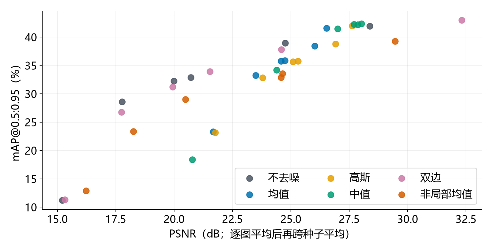

图5：每点为一个噪声类型、强度、方法的三种子均值，共36点。不同点的输入强度并不相同；该图用于显示二者非一一对应，不能把跨条件相关性解释为画质变化的因果系数。

PSNR惩罚每个像素误差，检测器更关心可分辨的类别与空间结构。抹平噪声也可能抹掉小目标；少量高频残差可能降低PSNR但保留检测证据。双边与非局部均值的固定强度参数不随噪声调整，不能把不适配某一档噪声归为方法普遍无效。

### 4.5 案例分析：收益与代价

案例选择规则在生成程序中固定：seed42、椒盐3%中值选择相对不去噪(TP−FP)变化最大的一张；高斯σ25均值选择变化最小的一张；若变化值相同，收益案例取较大图像ID，代价案例取较小图像ID。它们是极端示例，用于展示误检漏检机制，不能代表发生比例，也不据此宣布某方法总体优越。

### 案例：COCO 88040，salt_pepper=0.03，中值

不去噪TP/FP/FN=5/7/8，滤波后=10/1/3；(TP−FP)变化+11。局部裁剪坐标为[81, 169, 191, 277]，以最小面积非crowd真值框外扩选取。所有预测框来自正式记录，未为图示重新推理。

按官方匹配追踪同一真值，新增匹配的目标为cup 2个、bottle 2个、fork 2个；失去原有匹配的目标为spoon 1个；具体真值ID保存在analysis_summary.json。这里同时涉及定位、类别和置信度变化，不能只看清晰度或仅凭框图确定原因。

本例新增6个真值匹配，同时失去1个原有匹配；总体收益不能解释为每个目标都获益。

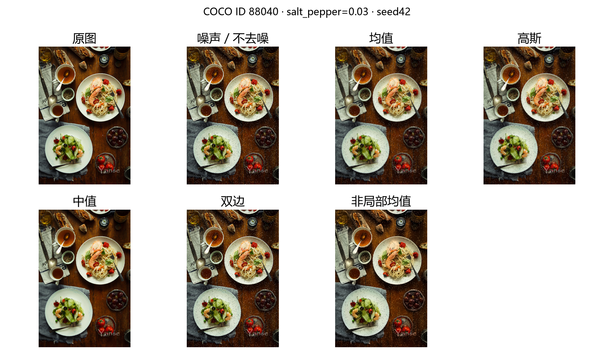

图：原图、噪声与五种处理。图像为COCO val2017，对应来源URL与许可见data_manifest.json该ID。

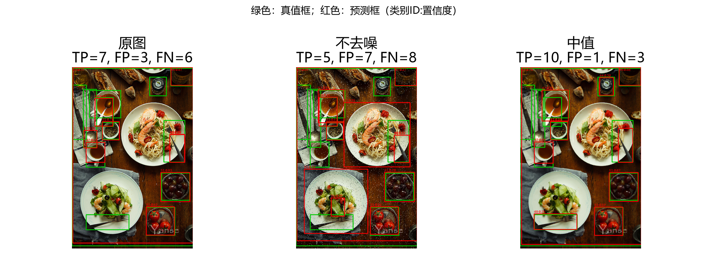

图：绿色为非crowd真值，红色为置信度≥0.25预测；重叠框不等于成功匹配，还须类别相同与IoU达标。红字为COCO类别ID和置信度。

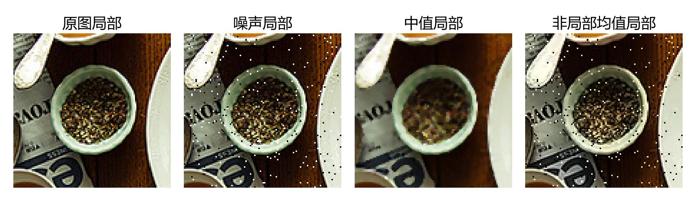

图：同一坐标区域按最近邻展示，观察轮廓、细纹与残留脉冲。局部锐利度只能作为视觉线索，实际检测判断以匹配记录为准。

### 案例：COCO 163117，gaussian=25，均值

不去噪TP/FP/FN=14/1/13，滤波后=7/3/20；(TP−FP)变化-9。局部裁剪坐标为[196, 186, 240, 230]，以最小面积非crowd真值框外扩选取。所有预测框来自正式记录，未为图示重新推理。

按官方匹配追踪同一真值，新增匹配的目标为无；失去原有匹配的目标为kite 7个；具体真值ID保存在analysis_summary.json。这里同时涉及定位、类别和置信度变化，不能只看清晰度或仅凭框图确定原因。

本例失去7个原有匹配，类别为kite 7个。局部图中很小的轮廓被均值平滑，提示小目标证据与随机高频同时被处理；具体定位或分数变化仍应按保存的框与置信度核查。

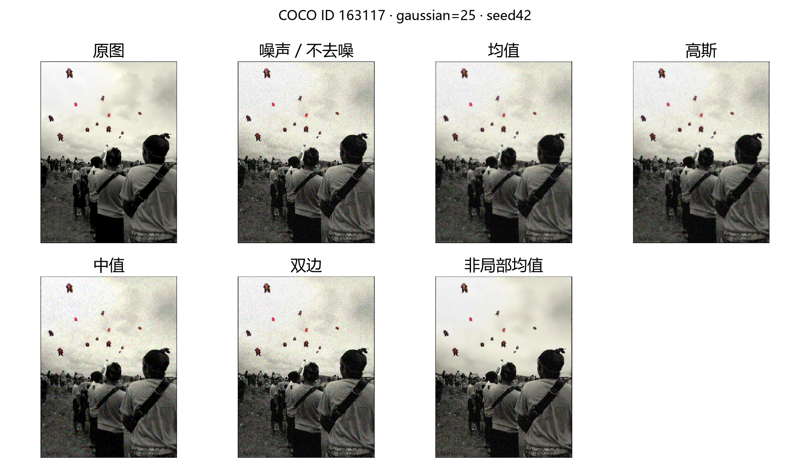

图：原图、噪声与五种处理。图像为COCO val2017，对应来源URL与许可见data_manifest.json该ID。

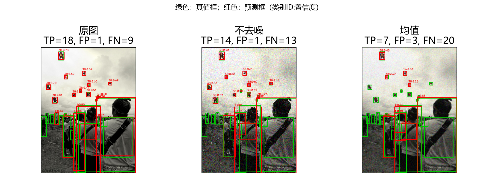

图：绿色为非crowd真值，红色为置信度≥0.25预测；重叠框不等于成功匹配，还须类别相同与IoU达标。红字为COCO类别ID和置信度。

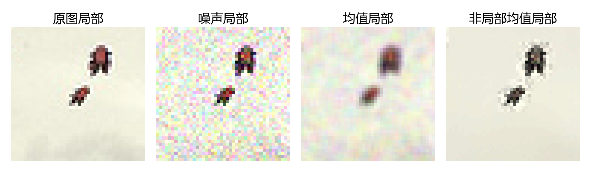

图：同一坐标区域按最近邻展示，观察轮廓、细纹与残留脉冲。局部锐利度只能作为视觉线索，实际检测判断以匹配记录为准。

### 4.6 耗时与收益成本

| 方法 | 去噪ms/张 | 检测ms/张 | 合计ms/张 |
| --- | --- | --- | --- |
| 不去噪 | 0.04 | 10.43 | 10.47 |
| 均值 | 0.48 | 10.35 | 10.83 |
| 高斯 | 0.22 | 10.35 | 10.58 |
| 中值 | 0.11 | 10.55 | 10.66 |
| 双边 | 1.77 | 11.25 | 13.02 |
| 非局部均值 | 473.33 | 10.97 | 484.30 |

表5：先求每个条件内的逐图平均，噪声条件再按三个种子汇总。每种方法最终得到7组结果（1组干净输入、6组噪声类型与强度组合），表中对这7组同权平均。合计仅为滤波＋检测，不包含读图与报告生成。非局部均值搜索更多块，带来的开销需与检测收益一起判断；图像更复杂时NMS和预测数量也会改变检测耗时。

## 5. 实际难点与处理方法

### 5.1 GPU环境兼容

最初检测到的PyTorch 2.7.1+cu118能完成基础张量和卷积，却提示RTX 5070 Ti的sm120不受该构建正式支持。真实YOLO预热长时间未返回，不能由基础CUDA测试通过推出检测器可用。中断该进程后，在项目虚拟环境中安装2.7.1+cu128与对应torchvision，再完成真实图像六方法推理与小矩阵，正式实验才统一启用GPU。耗时统计从环境调整后的正式运行开始；早期挂起的原因尚不能定位到某个具体算子。

### 5.2 路径、下载与配置权限

Windows中文和空格路径下使用fromfile＋imdecode、imencode＋tofile，避免直接路径解码的不一致。工作目录固定为项目根，数据路径来自相对配置。Ultralytics默认用户目录配置写入受限，改为项目.cache/ultralytics；Matplotlib缓存也设在项目内。

直接GitHub权重下载与Git传输遇到连接重置，改用官方GitHub资产API下载并检查SHA256。COCO官方验证标注从支持Range的ZIP中只提取所需文件，图像失败重试；无法验证解码的文件不作为成功下载。

### 5.3 颜色、缩放与类别映射

OpenCV使用BGR；传NumPy数组给Ultralytics时由其内部按API约定转换，自己再交换通道会造成错误。Matplotlib展示时才BGR转RGB。真值框使用精确sx/sy，预测框使用模型映射回原处理图像的坐标，避免把letterbox尺寸和处理图坐标混用。COCO类别ID有空号，所以显式用80类别列表映射，未用cls+1。

### 5.4 评价与运行记录

直接统计预测框数量，容易忽略重复匹配、crowd区域和空预测等情况。改用COCOeval统一匹配，基础检查包含重复预测、错类别、crowd、空预测。AP保留低置信度尾部，F1单独阈值化。每图记录预测、质量、耗时与处理图哈希，每条件保存指纹；断点恢复禁止旧输入与新参数混在一起。

分阶段验证还发现：命令行浮点25.0与JSON整数25进入字符串随机键时表示不同，会造成演示与正式实验的噪声不一致。演示入口将整数强度归一为int后再传给同一核心函数，重新核对默认演示与正式配置的噪声像素相同。正式矩阵使用固定JSON整数强度，未改变核心实验输入。

彩色非局部均值最耗时，因此先完成8张小矩阵验证，再一次运行正式矩阵。报告直接读取原始记录，避免报告生成时重复检测或产生另一套预测结果。各组结果先落盘，运行被打断时只需补齐尚未完成的条件。

## 6. 结果解释、局限与总结心得

### 6.1 可以支持的结论

固定参数的滤波选择依赖噪声类型与强度，保边操作与排序操作有不同信息取舍。应同时看AP、固定阈值P/R/F1、图像质量、局部细节和耗时，而不能只看一张“更干净”的图。干净对照揭示额外处理自身的损失；成对噪声输入排除了各方法使用不同随机图像的比较偏差。

本次高斯噪声11/15、椒盐噪声7/15个滤波组合在平均AP上超过不去噪；其余未超过，并不等于这些方法在所有参数下无效。不同噪声分布、模型、输入分辨率或滤波参数都可能改变结果。成对AP差的三个种子原值、均值和标准差保存到analysis_summary.json，可核查收益是否对随机实现敏感。

### 6.2 局限与工业缺陷启发

128张只是COCO固定小样本，部分类别没有真值；三个种子只检验噪声随机性，不检验抽样方差。合成噪声不含工况照明、模糊、压缩、纹理变化等复杂因素；固定预训练模型没有对噪声训练。标准差不是显著性证明，也没有跨模型实验。本作业检测普通目标，并没有验证工业缺陷算法或在线学习。

对于弱划痕、小缺口等缺陷，高频可能恰好是必须保留的证据。联系DCP-SFR与UniRestore，可把“恢复清晰度”转为“保持下游证据”的研究问题：在冻结参考模型下分别评估正常漂移适应与弱缺陷得分保持，然后才考虑在线更新。若处理把重复缺陷变得像正常样本，还需独立监控参考库污染与回滚；本实验提供取舍示例，不证明该时序机制已经解决。

### 6.3 实验心得与后续改进

实现过程中，环境兼容性、细节保留和评价匹配是最需要检查的三个环节。基础CUDA测试通过后，仍需运行完整模型确认设备兼容；比较去噪结果时，应把局部图像、检测指标和真值匹配放在一起分析。保留输入、参数及逐图预测，有助于定位异常结果，也能让后续的指标核算和案例分析有据可查。

后续可在独立调参集比较窗口大小与h，在另一批图像和检测器上检验结论，再加入接近真实工况的退化。改动应使用新的输出目录，保留本次固定实验记录。

## 7. 复现入口与记录索引

- configs/full.json：固定设计及所有算法/检测参数。
- results/full/environment.json、config.json、completion.json：实际环境、指纹和114组运行摘要。
- results/full/data_manifest.json、annotations_resized.json：来源、许可与缩放真值。
- results/full/conditions：每条件汇总；records：逐图预测、TP/FP/FN、质量、时间和图像哈希。
- results/full/condition_results.csv：114行；aggregate_results.csv/json：42行均值与标准差。
- analysis_summary.json：成对AP差与案例选择结果；generate_report.py可从正式记录重建本文数字和图表。

个人PyCharm指南与练习记录在两个仓库之外的local-learning，不提交GitHub。

## 参考资料

[1] [OpenCV平滑滤波官方说明](https://docs.opencv.org/4.x/d4/d13/tutorial_py_filtering.html)。

[2] [OpenCV非局部均值官方说明](https://docs.opencv.org/4.x/d5/d69/tutorial_py_non_local_means.html)。

[3] [Ultralytics YOLO11官方模型文档](https://docs.ultralytics.com/models/yolo11/)，[固定发布资产](https://github.com/ultralytics/assets/releases/tag/v8.3.0)。

[4] [COCO数据下载](https://cocodataset.org/#download)，[官方bbox评价实现](https://github.com/cocodataset/cocoapi/blob/master/PythonAPI/pycocotools/cocoeval.py)。

[5] [scikit-image结构相似度API](https://scikit-image.org/docs/stable/api/skimage.metrics.html#skimage.metrics.structural_similarity)。

[6] 第三章课件，第10页作业要求与第29—41页相关滤波内容；作业1中DCP-SFR与UniRestore论文分析。
