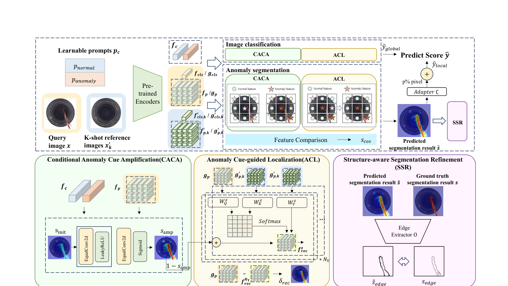
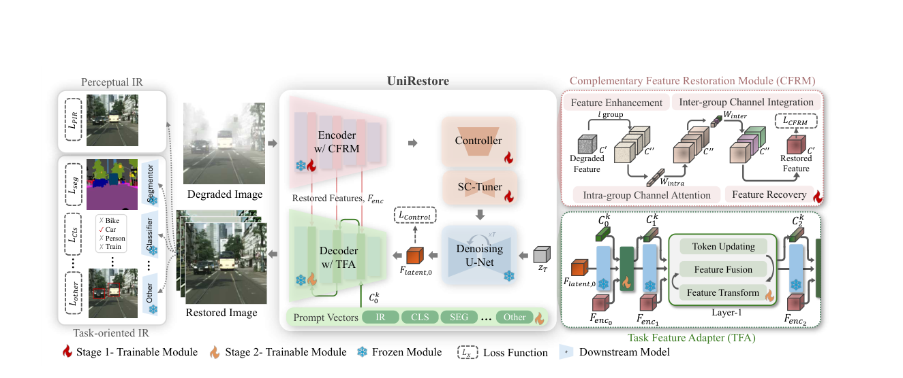

# 图像处理如何保留检测所需信息
## DCP-SFR（CVPR 2026）与 UniRestore（CVPR 2025）的阅读与分析

计算机视觉第三章 · 作业1

本文分析已发表论文，并联系当前工业异常检测研究构想。两篇论文的完整模型未在本作业中训练或复现，所有文献实验数字均为作者报告。

## 摘要

图像处理不仅要改善外观，还要保留后续视觉任务所需的证据。本文选择近期两篇CVPR论文：DCP-SFR利用异常线索增强、参考重建与结构约束改善工业缺陷定位；UniRestore将恢复后的编码器特征与扩散先验按任务融合，兼顾图像质量与识别效果。两者都显式重用任务相关信息，但工作对象、监督条件和指标不同。结合第三章知识与当前idea，本文分析局部处理、多尺度表示、边缘约束及任务导向恢复的作用，并讨论需要验证的缺陷证据保护问题。

## 1. 选题依据与课程联系

课件第10页要求自主阅读CVPR论文，分析图像处理技术的方法与作用。本文以“处理后还有多少任务信息”作为共同问题。课件第29—36页介绍线性滤波与邻域处理，第41页讨论依据噪声类型选择滤波器，后续介绍金字塔与几何变换。DCP-SFR对应特征域的局部异常与空间边界处理；UniRestore对应图像恢复、卷积、池化和多尺度融合。

当前研究主线关注工况变化与重复缺陷并发时，在线异常检测器如何适应新的正常外观，同时保护缺陷证据。DCP-SFR直接讨论特征提取过程中的缺陷线索衰减；UniRestore区分人眼偏好的图像质量与机器需要的任务信息。二者有助于判断：前处理或适应步骤是否改变了应保留的异常信号。

必须区分两种衰减：DCP-SFR研究单次前向处理中空间线索的损失；当前idea关注跨时间更新正常参考后，重复缺陷的异常分数下降。它们不是同一机制，不能据前者的结果直接证明后者。

## 2. 论文一：DCP-SFR

### 2.1 文献信息与监督条件

Le Jiang等，Defect Cue-Preserved Structural Feature Refinement for Few-Shot Anomaly Detection，CVPR 2026，出版页35607—35616。[1]

任务包含图像级正常/异常判断和像素级分割。目标域测试提供K张正常参考图，比较1-shot、2-shot和4-shot。CLIP与DINOv2骨干冻结，但提示、重建模块等需要训练。第4.1节说明在MVTec AD训练、VisA测试，反向也做；损失使用图像标签和像素掩码。因此，“1-shot”不表示整个模型只见过一张正常图或从未使用异常监督。

### 2.2 方法流程

查询图像与正常参考 → CLIP/DINOv2特征 → 条件异常线索放大CACA → 线索引导重建定位ACL → 结构感知分割细化SSR。图像级分支结合全局token与局部分数，像素分支保留位置网格。

图1：原论文Figure 2节选，来源[1]，出版页35610。CACA、ACL和SSR分别承担初始线索形成、参考重建和边界细化；不是本作业的复现结果。

### 2.3 CACA：增强初始异常线索

CACA将正常与异常的可学习文本提示，与多个层级的CLIP patch特征比较。异常提示带有damaged语义锚点。每个位置的余弦相似度经温度τ与softmax转换为异常概率，再对m个层级平均，得到初始异常图s_init（式4）。

多层特征提供不同尺度的信息，提示帮助区分哪些局部差异可能是缺陷。但相似度产生的概率不是噪声估计，也不是无需校准的真实错误概率。式5利用学习的非线性映射A增强响应：

$$s_{\mathrm{amp}}=\mathrm{sigmoid}\left(A(s_{\mathrm{init}})\right)$$

s_init是初始异常图，A是学习式映射，s_amp是增强后的空间线索。它与对比度变换有拉开响应差异的共同目的，但不能等同于独立作用于原始RGB像素的伽马校正。初始判断错误时，模块也可能增强错误线索，需在真实工况变化下另外评测。

### 2.4 ACL：以正常参考重建并保留残差

ACL以查询图的DINOv2特征作为query，正常参考的平均特征作为key/value，使用交叉注意力重建正常模式。后续层将上一层结果乘以(1 − s_amp)，抑制被标为异常的位置，使重建更多依赖正常参考（式6—7）。

抑制的是重建分支中的异常内容，目的是避免异常被重建得过好。最终仍以查询特征和正常重建特征的差异作为检测证据（式8）：

$$\delta_{\mathrm{rec}}=\left\|g_p-f_{\mathrm{rec}}\right\|_1$$

g_p是查询patch特征，f_rec是最后一层重建特征。不能将重建分支的抑制解释为直接降低最终异常分数。若重建趋向正常外观，异常位置应留下残差。

参考数量少、姿态不一致或光照变化大时，正常位置也可能重建不好而产生大残差。因此，重建残差不是缺陷的充分证明。参考特征取平均还需要考虑空间对应，正文没有给出对任意失配场景的保证。

### 2.5 SSR：正常相似度与边缘约束

SSR将正常参考patch组成记忆库M。每个查询patch寻找最大余弦相似度Ψ，再取s_cos = 1 − Ψ，式11融合两类证据：

$$\hat{s}=\delta_{\mathrm{rec}}+\lambda s_{\mathrm{cos}}$$

λ控制正常参考不相似度的权重。训练还对预测掩码与真值掩码提取边缘，使用Dice形式的边缘一致性损失L_C（式12），使缺陷边界更精确。

这与第三章的边缘与结构处理有关，但正文未充分指定边缘提取器O，不能擅自写成作者使用Canny。另需注意，式11是相加：s_cos非负时不会直接减小已有正残差。误报减少应结合训练与阈值解释，不能只凭加法公式宣称逐位置的误报抑制保证。

### 2.6 原文实验依据

作者使用冻结CLIP ViT-L/14@336px与DINOv2，提示长度12，训练25个epoch，batch size 8，Adam学习率0.01；λ=1、μ=2、β=2。指标包括图像AUROC、像素AUROC、PRO、AP及F1-max。

| 设置与指标 | AnomalyDINO | DCP-SFR | 差值 |
|---|---:|---:|---:|
| MVTec AD，1-shot，图像AUROC（%） | 96.6 | 97.3 | +0.7个百分点 |
| MVTec AD，1-shot，像素AP（%） | 56.5 | 61.2 | +4.7个百分点 |
| VisA，1-shot，图像AUROC（%） | 87.4 | 92.0 | +4.6个百分点 |
| VisA，1-shot，像素AUROC（%） | 97.8 | 98.2 | +0.4个百分点 |
| VisA，4-shot，像素F1-max（%） | 46.4 | 47.1 | +0.7个百分点 |

表1：来源[1] Table 1，出版页35613。同一行才可直接比较。这些是作者结果。摘要中的图像AUROC 97.3%与像素AUROC 98.2%分别对应不同数据集的1-shot结果，不能作为同一数据集的一对指标。

VisA 1-shot消融表（Table 2，出版页35614）中，完整模型像素AUROC为98.2%，去掉SSR、ACL、CACA后分别为97.1%、96.7%、97.4%。这些结果支持模块在该配置下的经验贡献，但不保证对任意噪声有效。

原文存在需要核对的数值差异：Table 1的完整模型VisA 1-shot像素F1-max/AP为44.9/40.4；Table 2为44.6/39.9，正文未充分解释原因。本文分别引用，不将主表与消融表拼成统一基线。后续复现须核对配置与随机种子。

### 2.7 优点与局限

方法把初始异常线索贯穿到重建和边界优化，同时使用语义提示与正常参考。与只对固定特征计算距离相比，它显式处理后续步骤可能丢失的局部证据。

局限包括错误线索放大、正常参考覆盖不足、双骨干资源成本与监督训练迁移问题。跨域结果不能直接解释为在线适应，更不涉及来源追踪或回滚。对当前idea的价值是单次处理内部的证据保护启发，而非已解决重复缺陷吸收。

## 3. 论文二：UniRestore

### 3.1 文献信息与问题

I-Hsiang Chen等，UniRestore: Unified Perceptual and Task-Oriented Image Restoration Model Using Diffusion Prior，CVPR 2025，出版页17969—17979。[2]

感知恢复PIR关注PSNR、SSIM等质量指标；任务导向恢复TIR关注分类、分割和检测效果。只优化图像外观可能改变识别网络依赖的纹理，只优化某个任务也可能牺牲可视质量。论文的目标是减少这一矛盾。

### 3.2 整体信息流

退化图像进入带CFRM的VAE编码器，一路形成恢复后的多尺度编码特征，一路通过Controller、SC-Tuner与扩散U-Net恢复潜变量。解码阶段，TFA根据任务提示融合编码侧与扩散侧特征，输出适合当前任务的图像。

图2：原论文Figure 2节选，来源[2]，出版页17971。不同任务提示控制解码侧融合。扩散中的去噪是潜变量生成过程，不能与OpenCV对传感器噪声的滤波直接等同。

扩散先验提供恢复能力，编码特征保留输入仍有用的信息。对于工业缺陷，生成图像看起来更自然不等于保留了真实微小缺陷；这是一项需要评测的风险，本文不声称UniRestore已经被证明会删除缺陷。

### 3.3 CFRM：恢复编码侧的多尺度信息

CFRM包括特征增强、组内通道注意力、组间通道整合和特征恢复。NAFBlock、卷积与归一化先增强表示并扩展通道，再分组；组卷积和平均池化产生组内权重，另一条池化—卷积路径产生组间权重；卷积合并后，通过跳跃连接保留原特征。

卷积对应邻域加权处理，池化聚合统计，多尺度编码提供不同分辨率信息，跳跃连接让后续步骤继续使用输入细节。注意力权重依赖输入且含非线性，因此整个模块不是固定线性滤波器。

原文将GELU展开为Gate Linear Unit，而标准术语为Gaussian Error Linear Unit。本文按缩写与图示理解，不将文字错误扩展成不同结构。

### 3.4 TFA：根据任务提示融合特征

TFA共享主要适配结构，每个任务使用轻量提示向量C_i^k，逐解码层更新，再调制编码特征，与同尺度扩散特征融合（式1）。门控更新可概括为：

$$C_{i+1}^{k}=f_i\odot C_i^{k}+i_i\odot\tanh\left(h_i\right)$$

k表示任务，i表示层级，f_i与i_i控制旧提示和新信息，h_i由恢复特征投影得到，⊙是逐元素乘法。具体投影以原文为准。原文对σ的说明为softmax，不能因为它借鉴LSTM就擅自改成sigmoid。

这与金字塔有多尺度表示的共同思想，但不等于直接构造高斯图像金字塔，也不是几何配准方法。按任务融合使同一输入的恢复过程可以针对不同信息需求调整。

### 3.5 训练与复现注意点

第一阶段用成对干净/退化图像训练CFRM、Controller和SC-Tuner；第二阶段冻结这些模块，训练TFA及任务提示，联合PIR的MSE、分类交叉熵与分割交叉熵。增加检测任务时，引入并优化新的任务提示。

第3.4节开头称有三个阶段，正文详细展开Stage 1、Stage 2及新增任务流程；Figure 2概括为两个阶段。补充材料第3.1节明确第三阶段是单独微调新增任务提示。因此可以按“两个主要训练阶段＋新增任务适配”理解，两处图文采用不同概括范围。

原文式2将CFRM损失写成加权特征差之和，未显式给出范数与归约操作。不能未经代码核对改写成标准L2损失。式3潜变量损失则明确是平方L2。本文分析特征对齐意图，不声称原文已经给出完整可执行实现。

### 3.6 原文实验与效果

恢复训练用DIV2K、Flickr2K、OST，分类使用ImageNet子集，分割使用Cityscapes，合成15类退化。分类训练模型为ResNet-50，评价同时使用ResNet-50与ViT-B；分割训练用DeepLabv3+，评价另用RefineNet-lw。跨模型评价支持一定的任务泛化，但不能代表所有检测器。

| 场景与指标 | 对照值 | UniRestore | 差值 |
|---|---:|---:|---:|
| Noise组合数据集PSNR（dB） | DiffUIR：24.27 | 24.37 | +0.10 dB |
| Noise组合数据集SSIM | DiffBIR：0.7661 | 0.7811 | +0.0150 |
| ImageNet，ResNet-50 ACC（%） | LQ：51.75 | 71.65 | +19.90个百分点 |
| CUB，ResNet-50 ACC（%） | LQ：33.69 | 53.70 | +20.01个百分点 |
| Cityscapes，DeepLabv3+ mIoU（%） | LQ：40.36 | 66.05 | +25.69个百分点 |
| RTTS，RetinaNet mAP（%） | LQ：45.63 | 58.06 | +12.43个百分点 |

表2：来源[2] Tables 1—3、6，出版页17974—17976。LQ为退化输入。Noise由多个图像数据集组成，不是COCO噪声设置。RTTS的mAP按原文命名，不改称COCO mAP@0.5:0.95。

Table 4中，完整模型的PSNR/ACC/mIoU为24.32/71.65/66.05；去掉CFRM为21.43/63.10/55.48；去掉TFA为22.16/64.25/58.13。这支持模块在作者协议下的作用。检测扩展使用RetinaNet与合成退化COCO训练数据，测试RTTS，仍需要检测监督，不是零样本切换提示。

Table 5中，共享TFA需要调整21.03M参数，多任务独立TFA为63.03M。这是调节参数量，不是完整扩散模型规模。[补充材料](https://openaccess.thecvf.com/content/CVPR2025/supplemental/Chen_UniRestore_Unified_Perceptual_CVPR_2025_supplemental.pdf)第3.1节另报SD-turbo为975M冻结参数、Controller约74.7M、CFRM约26M、TFA约21M；阶段与统计对象必须区分。

补充材料第3.2节说明仅使用一步扩散去噪。作者在RTX 4090、512×512输入下测得编码16 ms、一步去噪113 ms、解码3.8 ms，显存6.44 GB；三部分相加约132.8 ms，不含后续识别器，不能与本作业整张检测耗时直接比较。这些仍是作者测量，本作业未复测。

补充材料Table 9更直接展示视觉质量与任务收益的区别：PIR提示对应PSNR 24.32 dB、分类ACC 67.60%；分类提示对应22.12 dB、71.65%。分类更好时PSNR反而更低，说明评价应与任务对应。Table 7中，仅调新提示的COCO/RTTS mAP为29.53/58.06，完整微调为30.14/58.51；新提示少于1k参数并不意味着整个已训练模型少于1k参数。Table 10还展示增加PIR损失权重可提高PSNR而降低分类/分割指标，支持研究中分别检查质量、任务性能和信息保真。

### 3.7 与课程实验的关系

作业2据此同时评价PSNR、SSIM和固定YOLO检测器的精度。其检验的是传统滤波在受控噪声下的影响，不复现UniRestore，也不凭YOLO结果评价其扩散架构。

## 4. 横向比较与知识对应

| 维度 | DCP-SFR | UniRestore |
|---|---|---|
| 任务 | 工业异常分类与定位 | 图像恢复与多任务视觉 |
| 处理对象 | 特征、异常图、边界 | 图像、编码特征、扩散潜变量 |
| 证据来源 | 语义提示与正常参考 | 输入信息、扩散先验、任务监督 |
| 信息保留 | 线索增强、参考重建、边缘约束 | 编码恢复、跳跃连接、任务融合 |
| 训练监督 | 辅助域图像标签与掩码 | 恢复配对和任务标签 |
| 主要风险 | 错误线索增强、参考覆盖不足 | 生成先验与真实细节偏差 |

两篇论文都不支持“去噪越强、检测越好”的普遍结论。小结构可能被当作噪声，噪声也可能被当作异常。应分别检查正常误报与弱缺陷漏报。

| 第三章知识 | 论文中的对应环节 | 应注意的区别 |
|---|---|---|
| 点操作与对比度调整 | CACA增强异常响应 | 作用于学习式异常图，非单纯RGB点变换 |
| 线性滤波、邻域统计 | CFRM卷积与平均池化 | 完整网络含非线性，非固定线性算子 |
| 边缘与空间结构 | SSR边缘一致性损失 | 正文未指定Canny，且需要训练掩码 |
| 金字塔、多尺度表示 | 多层patch与编码—解码特征 | 特征金字塔不等于像素高斯金字塔 |
| 几何对齐 | 同尺度特征融合的空间对应 | 两篇均不能直接视为任意姿态配准器 |

课件第30页将均值滤波列为非线性例子，第31与36页又将它列为线性。固定核均值滤波满足叠加和齐次，应归为线性；中值和双边滤波通常是非线性的。本文与作业2采用这一定义。

## 5. 对当前idea的具体启发

### 5.1 分开诊断处理损失与记忆污染

第一条路径是输入与特征处理改变弱缺陷内容；第二条路径是异常patch进入正常参考库，使后续类似缺陷距离变小。先冻结骨干与参考比较不同前处理，再固定前处理比较冻结与在线更新，才能定位分数下降的来源。DCP-SFR提供处理链的线索保护思路，UniRestore提供任务导向评价思路，PatchCore提供可观察的静态patch记忆基线。[3]

### 5.2 候选隔离与来源回滚

具体构想维护冻结参考、活动记忆、隔离记忆与提交日志。每帧先用旧状态预测并锁定记录，再决定是否隔离或更新。候选记录来源图、patch坐标、提交版本及被替换项。后续监测同类缺陷分数衰减、集中写入及旧工况退化，在预先确定的风险条件触发时撤销对应来源的提交。

这是待验证方案，不是本作业已实现模块。重复出现或跨增强一致不能证明正常；测试标签不能用于选择更新样本和阈值。来源回滚是否优于冻结、严格筛选或全量重置，必须公平比较。

### 5.3 验证与停止条件

验证采用四格：无变化/无污染、仅工况、仅重复缺陷、两者并发。在至少两个公开数据源和三个流顺序种子上，报告固定阈值FPR/FNR、缺陷分数保持、记忆污染率、旧工况保持及更新/回滚延迟。污染标签只用于事后诊断。

若现有方法没有可重复衰减，或Oracle正常更新不能改善真实工况误报，就不继续开发复杂回滚。作业2的自然图像与人工噪声实验不能替代工业验证，也不能证明候选方法新颖。

## 6. 总结

现代图像处理不仅存在于输入端，也存在于特征、潜变量和边界处理中。DCP-SFR强调线索贯穿流程，UniRestore强调恢复与任务目标对齐。最有用的研究启发，是把信息保留落实为可检查的中间记录与任务指标，而不是凭恢复图像是否好看来判断有效性。

本文完成原文阅读、方法分析与研究问题梳理；后续作业2通过实际OpenCV实验检查图像质量与检测精度的变化。

## 参考文献

[1] Jiang L., Huang Y., Xu Z., Xu Y., Wong H.-S., Wu S. Defect Cue-Preserved Structural Feature Refinement for Few-Shot Anomaly Detection. CVPR, 2026: 35607—35616. [CVF出版页面](https://openaccess.thecvf.com/content/CVPR2026/html/Jiang_Defect_Cue-Preserved_Structural_Feature_Refinement_for_Few-Shot_Anomaly_Detection_CVPR_2026_paper.html)。

[2] Chen I.-H., Chen W.-T., Liu Y.-W., Chiang Y.-C., Kuo S.-Y., Yang M.-H. UniRestore: Unified Perceptual and Task-Oriented Image Restoration Model Using Diffusion Prior. CVPR, 2025: 17969—17979. [CVF出版页面](https://openaccess.thecvf.com/content/CVPR2025/html/Chen_UniRestore_Unified_Perceptual_and_Task-Oriented_Image_Restoration_Model_Using_Diffusion_CVPR_2025_paper.html)。

[3] Roth K., Pemula L., Zepeda J., Schölkopf B., Brox T., Gehler P. Towards Total Recall in Industrial Anomaly Detection. CVPR, 2022: 14318—14328. [CVF出版页面](https://openaccess.thecvf.com/content/CVPR2022/html/Roth_Towards_Total_Recall_in_Industrial_Anomaly_Detection_CVPR_2022_paper.html)。

[4] 课程课件：chapter 3 image processing.pptx，共176页；重点依据第10、29—41页及金字塔相关部分。

[5] 本地ideas资料：全局选题审计、Idea06研究构想与导师讨论稿、Top3深度论证及PatchCore阅读笔记。具体研究构想为尚待验证计划。
